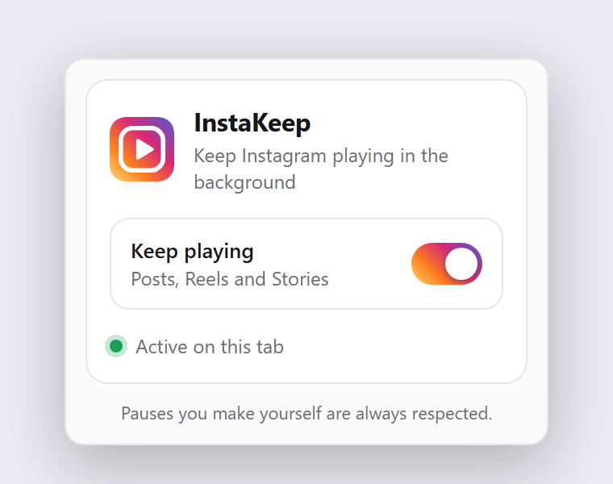
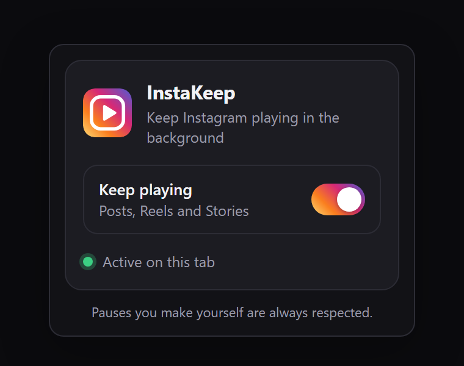

  

<h1 align="center">InstaKeep</h1>

  <strong>Keep Instagram videos playing when you switch tabs or windows.</strong> 
  A free, lightweight extension for Firefox.

  
  

---

Instagram pauses your video the moment you look away – switch to another tab, click on another window, and it stops. **InstaKeep fixes that.** Your posts, Reels and Stories keep playing in the background, so you can keep listening while you do something else.

## ✨ Features

- 🔄 **Smart Detection** – if *you* pause a video, it stays paused. InstaKeep only stops the automatic pauses that happen when you leave the page.
- ⚡ **Lightweight** – tiny and fast. No tracking, no constant background work, and it won’t slow down your browser.
- 🎯 **Instagram Only** – works on instagram.com and nowhere else.
- 🔧 **Easy Toggle** – turn it on or off with one click from the toolbar. No page reload needed, and the icon turns grey when it’s off.
- 🎨 **Modern UI** – a clean popup that follows your light or dark theme.

Works with **feed posts**, **Reels** and **Stories**.

## 📥 Install

  

Or open the [InstaKeep page on Firefox Add-ons](https://addons.mozilla.org/firefox/addon/instakeep/) and click **Add to Firefox**.

## 📸 Screenshots

  
  

## 🚀 How to use

1. Install InstaKeep.
2. Open [instagram.com](https://www.instagram.com/) and play any video.
3. Switch to another tab or window – the video keeps playing.

To turn it off, click the InstaKeep icon in the toolbar and flip the switch. The icon turns grey while InstaKeep is off, so you can always tell at a glance.

## ❓ FAQ

**Does it work on other websites?**
No. InstaKeep only runs on instagram.com.

**I paused a video and switched tabs. Will it start playing again?**
No. Pauses you make yourself – by clicking, tapping, using the keyboard or your media keys – are always respected.

**Does it work in Chrome?**
Not at the moment. InstaKeep is made for Firefox (version 140 or newer).

## 🔒 Privacy

InstaKeep collects **no data at all**. It doesn't track you, doesn't send anything anywhere, and doesn't read your Instagram account. The only thing it saves is your on/off setting, stored locally in your browser.

## 💬 Feedback

Found a bug or have an idea? [Open an issue](https://github.com/Antxj/instakeep/issues).

---

  InstaKeep is an independent project and is not affiliated with, endorsed by, or sponsored by Instagram or Meta. 
  Released under the <a href="LICENSE">MIT License</a>.

